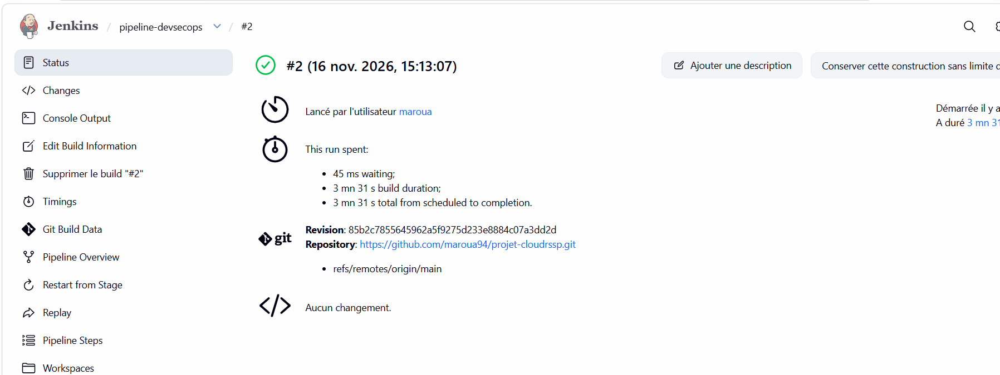
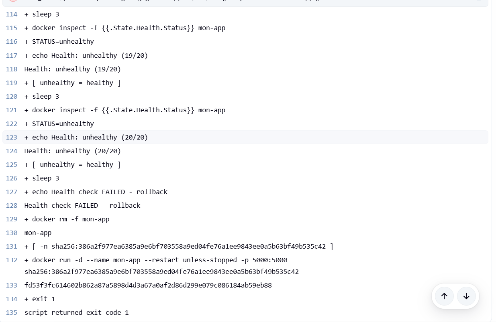
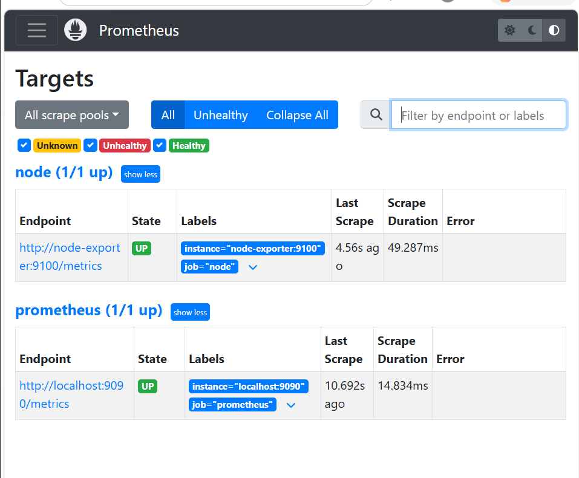
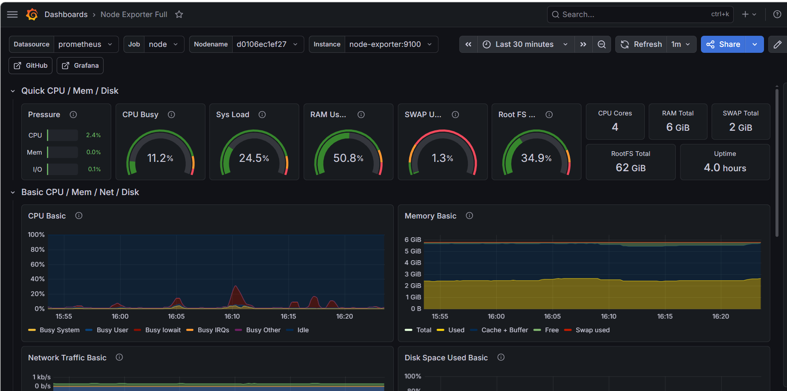
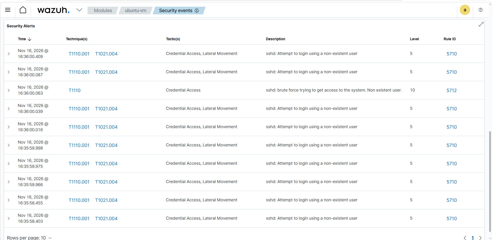

# Plateforme Cloud Sécurisée DevSecOps

Projet académique (ENSA Marrakech) : un pipeline de livraison continue sécurisé, sa supervision et la détection d'intrusion, le tout sur une machine virtuelle Ubuntu.

L'idée de départ est simple : aucun code ne doit arriver en production sans avoir été testé, vérifié pour les secrets oubliés et scanné pour les vulnérabilités.

## Architecture

Tout tourne dans une VM Ubuntu 22.04 (Vagrant + VMware). Le code part de GitHub, Jenkins le teste et le déploie dans Docker, pendant que Prometheus et Wazuh surveillent la machine.

```
GitHub ──> Jenkins ──> Docker ──> Application Flask

Node Exporter ──> Prometheus ──> Grafana

Agent Wazuh ──> Manager ──> Indexer ──> Dashboard
```

## Le pipeline

Le `Jenkinsfile` enchaîne cinq étapes. Une étape qui échoue arrête tout.

| Étape | Outil | Ce qui est vérifié | Résultat |
|---|---|---|---|
| 1. Tests | pytest (build Docker multi-stage) | Les routes `/` et `/health` | 2/2 réussis |
| 2. Secrets | Gitleaks | Aucun secret dans le dépôt | 0 fuite |
| 3. Build | Docker | Image multi-stage, utilisateur non-root, HEALTHCHECK | image construite |
| 4. Scan | Trivy (HIGH et CRITICAL, `--ignore-unfixed`) | Vulnérabilités de l'image | 0 |
| 5. Déploiement | Docker | Contrôle de santé, puis retour à la version précédente si échec | conteneur healthy |

Trivy avait d'abord trouvé 2 vulnérabilités HIGH sur `zlib1g`. Je les ai corrigées en mettant le paquet à jour dans le `Dockerfile` : il en reste 0.



## Mise à l'épreuve

Un pipeline qu'on n'a jamais vu échouer ne prouve rien. J'ai donc provoqué trois échecs volontaires.

| Échec provoqué | Ce qui s'est passé | Build |
|---|---|---|
| Réponse de `/health` changée de « ok » à « ko » | `test_health` échoue, l'étape Tests est rouge et les suivantes sont sautées | #4 rouge, #5 vert après correction |
| Faux fichier `demo_secret.py` avec une fausse clé d'API | Gitleaks la détecte (`generic-api-key`) et bloque à l'étape Secrets | #6 rouge |
| Adresse du HEALTHCHECK changée en `/healthz` (inexistante) | Le conteneur reste « unhealthy » après 20 contrôles : le pipeline relance l'ancienne image et s'arrête en erreur, l'application continue de répondre | #8 rouge, #9 vert après correction |



## Supervision

Prometheus (v2.55.1) interroge Node Exporter toutes les 15 secondes. Grafana affiche ces mesures dans le tableau « Node Exporter Full » (ID 1860). La configuration est dans le dossier `monitoring/`.




## Détection d'intrusion

Un agent Wazuh (4.7.0) surveille la VM. J'ai simulé une attaque par force brute en SSH : Wazuh l'a détectée avec les règles 5710 (utilisateur inexistant) et 5712 (force brute SSH), associées à la technique MITRE ATT&CK T1110.



## Portail

Le dossier `portail/` contient une page web qui rassemble le projet et donne accès à chaque outil (Jenkins, Grafana, Prometheus, Wazuh, application).

```
cd portail
docker build -t portail .
docker run -d --name portail -p 8081:80 portail
```

Les ports des outils se règlent dans `portail/config.js`.

## Ce qui a coincé

- **docker.sock : permission denied.** Jenkins ne pouvait pas utiliser Docker. Contournement par `chmod`, à remplacer par l'ajout au groupe docker.
- **Erreur DNS « server misbehaving ».** La validation DNSSEC échouait dans systemd-resolved. Réglé avec `DNSSEC=no`.
- **Jenkins ignorait le Jenkinsfile.** Le job était de type Freestyle. Remplacé par un job Pipeline from SCM.
- **Accès Jenkins perdu.** Réinitialisation via `config.xml`, puis sécurité reconfigurée.

## Limites connues et suite

- Le `chmod 666` sur `docker.sock` est temporaire.
- Jenkins et ses plugins doivent être mis à jour.
- Les mots de passe par défaut de Wazuh sont à changer avant toute exposition publique.


## Déploiement du portail sur AWS (Terraform)

Le portail du projet a été publié sur Internet via AWS, créé entièrement par Terraform (infrastructure as code) : une instance EC2 Ubuntu 22.04, une IP Elastic fixe, un groupe de sécurité et un disque chiffré.

- **Public** : seul le port 80 était ouvert. Le site présentait le projet et l'architecture.
- **Privé** : Jenkins, Grafana, Prometheus, Wazuh et l'application restent sur ma machine virtuelle locale, non exposés sur Internet. Les cartes du portail ouvrent l'outil réel depuis mon réseau ; ailleurs, la page n'est pas accessible, volontairement.
- **Sécurité** : SSH fermé par défaut, IMDSv2 obligatoire, disque chiffré, aucun secret dans le dépôt (clés AWS fournies par variables d'environnement, `terraform.tfvars` ignoré par Git).
- **Reproductible** : `terraform apply` crée tout, `terraform destroy` supprime tout. Le site se reconstruit seul au démarrage à partir de ce dépôt.

Dossier : `terraform/`

## Technologies

Vagrant, VMware, Ubuntu 22.04, Docker, Jenkins, Python (Flask, pytest), Gitleaks, Trivy, Prometheus, Node Exporter, Grafana, Wazuh, Terraform, AWS (EC2).

